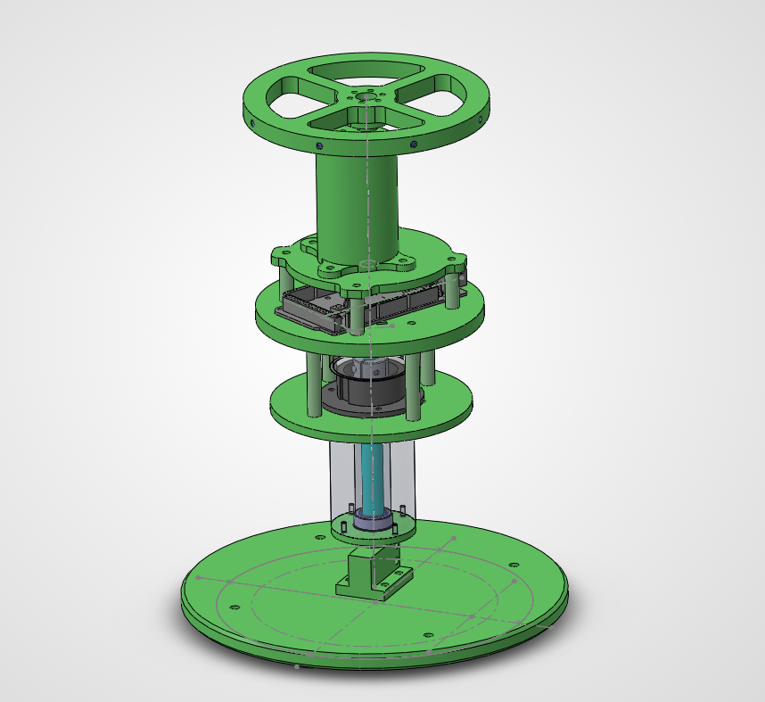

# Reaction Wheel Control Lab

A reaction-wheel teaching testbed developed for the EE 381 Control Systems Laboratory at King Fahd University of Petroleum and Minerals (KFUPM). The objective was to help control engineering students connect feedback-control theory with real electromechanical behavior through a physical system they could observe and control. This portfolio repository brings together SolidWorks mechanical designs, photographs and videos of the assembled prototype, and MATLAB studies of the wheel and rotating base.

| Physical prototype | SolidWorks design study |
| --- | --- |
|  |  |

[Watch the bench operation clip](evidence/videos/bench-operation.mp4) · [View the build evidence](evidence/README.md) · [Browse the CAD files](cad/README.md) · [Run the MATLAB model](simulation/README.md)

## Project work

| Area | Work shown |
| --- | --- |
| Mechanical design | A vertical wheel and motor stack, rotating base, structural decks, motor bracket, and electronics mounting. Designs began with CNC fabrication in mind and were adjusted for 3D printing during the build. The CAD folder includes native SolidWorks assemblies and parts, assembly views, and STEP exports. |
| Hardware integration | A physical rig with a spoked wheel, motor, stacked plates, and wired electronics. The build gallery shows the whole assembly and close-ups of the lower deck. |
| Modeling and control | A coupled wheel and base model with current, friction, drive limits, and battery behavior. The MATLAB package includes an open-loop voltage pulse, wheel-speed PI, and base-angle PD. |
| Gear ratio study | The same open-loop pulse applied to nominal 6:1, 10:1 and 19:1 model variants, with comparisons of base angle, relative wheel speed and current. |

## Run the simulation

Open MATLAB in this repository and run the existing entry points.

```matlab
cd('simulation/matlab')
RUN_TESTS_FIRST
RUN_OPEN_LOOP_COMPARE
```

The [simulation guide](simulation/README.md) describes the model assumptions, checks, and plotting entry points. The [system overview](docs/system-overview.md) connects the physical reaction-wheel testbed to the control model and its educational purpose.

## Educational purpose and fabrication

The reaction-wheel system was developed as a hands-on teaching platform for EE 381 Control Systems Laboratory students to study feedback control and apply concepts from the classroom to a real physical system. The mechanical designs were initially prepared with CNC manufacturing in mind. During fabrication, some components were modified to make them suitable for 3D printing. Consequently, the CAD files document the design work but may not reproduce every modification made to the assembled prototype.

## Evidence and scope

The photos and clips document the assembled prototype and its physical bench operation. The MATLAB studies and validation checks document modeled behavior; they do not, by themselves, establish that the simulated controllers were implemented on the physical rig. Measured closed-loop tracking error, repeatability, and simulation-to-hardware agreement are not included in the current repository. The exact CAD revision corresponding to the photographed build is unconfirmed because of the fabrication adjustments.

Project documentation credits **Muhammed Elyamani** in the context of the KFUPM EE 381 teaching lab. See [credits and rights](docs/credits.md) for component attribution and reuse considerations.
