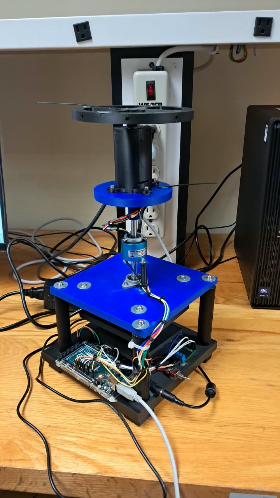
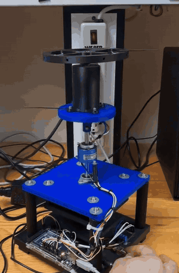

# Reaction Wheel Control Lab

**KFUPM · EE 381 Control Systems Laboratory · Teaching prototype**

A reaction-wheel testbed designed to help control engineering students connect **feedback-control theory** with the behavior of a real electromechanical system.

<p align="center">
  
  
</p>
<p align="center"><sub>Physical prototype (left) · SolidWorks design study (right)</sub></p>

<p align="center">
  
</p>
<p align="center"><sub>Looping excerpts from both bench demonstration clips</sub></p>

**[Watch the original bench video](evidence/videos/bench-operation.mp4)** · [CAD files](cad/README.md) · [Simulation code](simulation/matlab/) · [Additional photos](evidence/README.md)

## Operating principle

A motor accelerates the flywheel and applies an **equal and opposite reaction torque** to the rotating base. The motor acts on the wheel's motion *relative to the base*.

```math
\begin{aligned}
\omega_{\mathrm{rel}} &= \omega_w-\omega_b, \\
\tau_w &= \eta N K_t i, \\
J_b\dot{\omega}_b &= -\tau_w+\tau_{\mathrm{joint}}-\tau_{\mathrm{base}}+\tau_{\mathrm{ext},b}, \\
J_w\dot{\omega}_w &= +\tau_w-\tau_{\mathrm{joint}}+\tau_{\mathrm{ext},w}.
\end{aligned}
```

Here, subscripts **b** and **w** denote base and wheel; **J** is rotational inertia, **i** is motor current, **Kₜ** is the torque constant, **N** is the gear ratio, and **η** is transmission efficiency. These are the simplified equations without the optional reflected actuator inertia used in the [full MATLAB model](simulation/matlab/rw_dynamics.m).

## Control experiments

The MATLAB study implements three control modes:

| Mode | Learning objective |
| --- | --- |
| **Open-loop voltage** | Observe the reaction-wheel/base response to a voltage pulse |
| **Wheel-speed PI** | Regulate relative wheel speed using PI control and an inner current loop |
| **Base-angle PD** | Regulate base orientation using PD control and an inner current loop |

For base-angle PD control, wheel torque is requested **opposite** to the desired base torque:

```math
\begin{aligned}
e_\theta &= \theta_{\mathrm{ref}}-\theta_b, \\
\tau_{w,\mathrm{des}} &= -K_p e_\theta + K_d\omega_b, \\
i_{\mathrm{ref}}^* &= \frac{\tau_{w,\mathrm{des}}}{\eta N K_t}.
\end{aligned}
```

The requested current is then limited and passed to the inner PI controller. The model also represents electrical dynamics, friction, battery behavior, actuator limits, and [safety supervision](simulation/matlab/safety_supervisor.m).

## Prototype and fabrication

The SolidWorks design was initially intended for **CNC manufacturing**. Some parts were modified during fabrication for **3D printing**, so the published CAD is a design reference rather than a verified exact as-built revision.

## Run the MATLAB study

```matlab
cd('simulation/matlab')
RUN_TESTS_FIRST         % Open-loop, wheel-speed PI, and base-angle PD
RUN_OPEN_LOOP_COMPARE   % Compare nominal 6:1, 10:1, and 19:1 gearing
```

The [simulation results](simulation/README.md) report the following **modeled** peak currents in MATLAB R2025a:

| Open-loop pulse | Wheel-speed PI | Base-angle PD |
| ---: | ---: | ---: |
| 1.183 A | 0.497 A | 1.180 A |

All three scenarios passed the repository's numerical sanity checks. These are **simulation results**, not measured hardware tracking errors.

---

**Evidence:** The [photos and videos](evidence/README.md) show physical bench operation. The [MATLAB code](simulation/matlab/) documents modeled control behavior. Closed-loop hardware tracking and simulation-to-hardware agreement have **not** been quantified in this repository.

**Credits:** Muhammed Elyamani · KFUPM EE 381. [Component attribution and rights](docs/credits.md).
