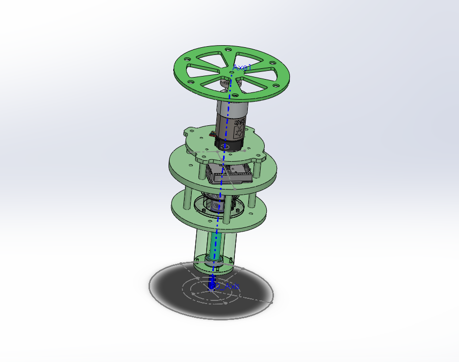

# Reaction Wheel Control Lab

A bench-top reaction wheel for the EE 381 Control Systems Laboratory at King Fahd University of Petroleum and Minerals (KFUPM). This portfolio repository brings together the SolidWorks mechanical design, photographs and videos of the assembled prototype, and MATLAB studies of the wheel and rotating base.

| Physical prototype | SolidWorks design study |
| --- | --- |
|  |  |

[Watch the bench operation clip](evidence/videos/bench-operation.mp4) · [View the build evidence](evidence/README.md) · [Browse the CAD files](cad/README.md) · [Run the MATLAB model](simulation/README.md)

## Project work

| Area | Work shown |
| --- | --- |
| Mechanical design | A vertical wheel and motor stack, rotating base, structural decks, motor bracket, and electronics mounting. The CAD folder includes the native SolidWorks assemblies and parts, assembly views, and STEP exports. |
| Hardware integration | A physical rig with a spoked wheel, motor, stacked plates, and wired electronics. The build gallery shows the whole assembly and close-ups of the lower deck. |
| Modeling and control | A coupled wheel and base model with current, friction, drive limits, and battery behavior. The MATLAB package includes an open-loop voltage pulse, wheel-speed PI, and base-angle PD. |
| Gear ratio study | The same open-loop pulse applied to nominal 6:1, 10:1 and 19:1 model variants, with comparisons of base angle, relative wheel speed and current. |

## Run the simulation

Open MATLAB in this repository and run the existing entry points.

```matlab
cd('simulation/matlab')
RUN_TESTS_FIRST
RUN_OPEN_LOOP_COMPARE
```

The [simulation guide](simulation/README.md) describes the checks, assumptions, and plotting entry point. The [system overview](docs/system-overview.md) explains how the rig and model relate.

## Evidence and scope

The clips document a physical bench demonstration. The simulation checks describe modeled behavior. Measured tracking error, repeatability, and simulation-to-hardware agreement are outside the evidence included here. The exact SolidWorks revision corresponding to the photographed build is unconfirmed.

Project documentation credits **Muhammed Elyamani** in the context of the KFUPM EE 381 lab. See [credits and rights](docs/credits.md) for the reference design and reuse status.
