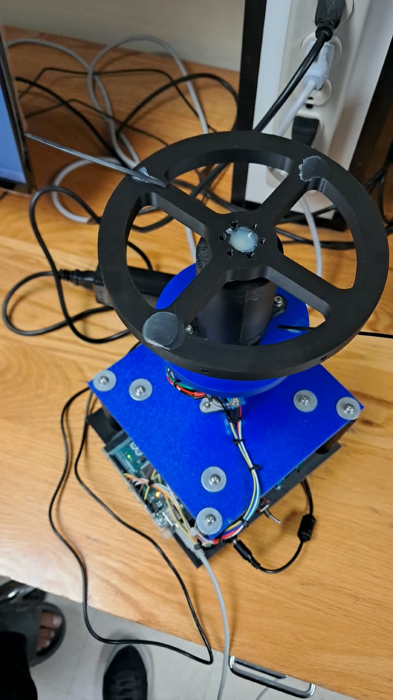
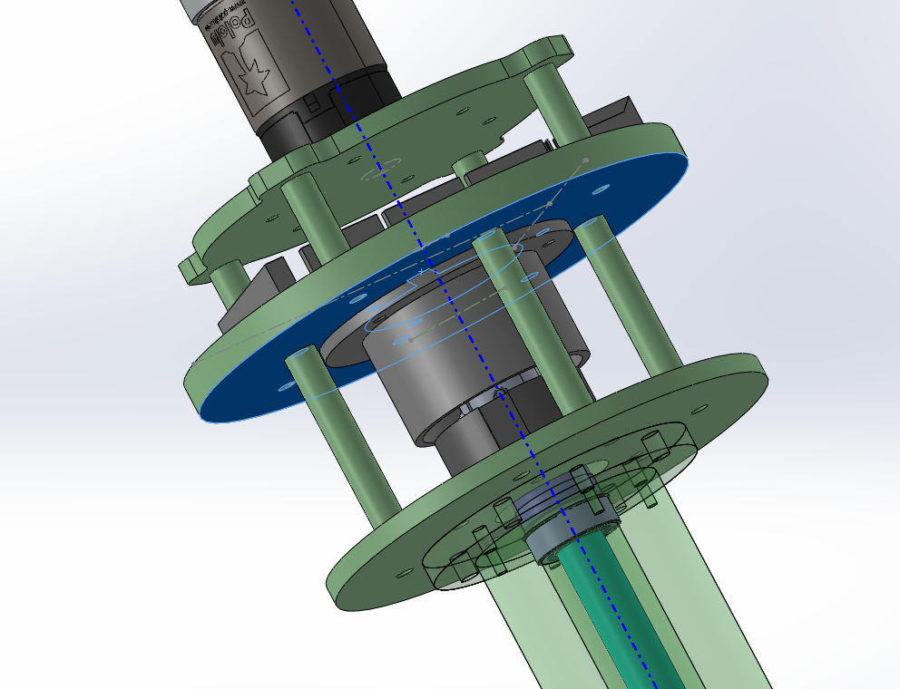
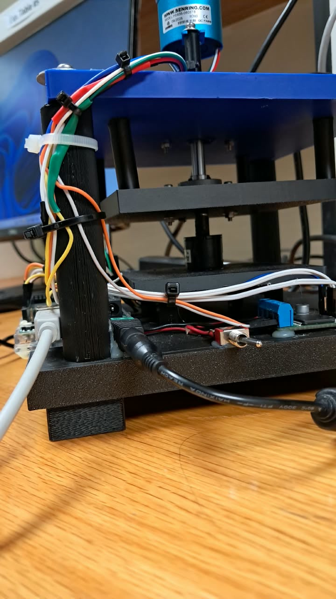

# Reaction Wheel Control Lab

**A physical control-systems teaching testbed for KFUPM EE 381**

Designed to help students move from feedback-control equations to an observable electromechanical system: a motor accelerates a flywheel, and the reaction torque changes the angle of the rotating base.

<p align="center">
  
  
</p>
<p align="center"><em>Assembled teaching prototype (left) and SolidWorks design study (right).</em></p>

**[Watch the physical bench demonstration](evidence/videos/bench-operation.mp4)** · [Additional clip](evidence/videos/short-operation.mp4) · [CAD and fabrication](cad/README.md) · [MATLAB simulation](simulation/README.md)

## How it works

The wheel and base rotate about a common vertical axis. The motor applies **equal and opposite torques** to the two bodies, so accelerating the flywheel produces a reaction on the base. The model tracks their **absolute** angles, while the motor acts on their **relative** motion.

| Symbol | Meaning |
| --- | --- |
| `\theta_b,\ \omega_b` | Base angle and angular velocity |
| `\theta_w,\ \omega_w` | Wheel angle and angular velocity |
| `J_b,\ J_w` | Base and wheel moments of inertia |
| `i,\ K_t,\ N,\ \eta` | Motor current, torque constant, gear ratio, efficiency |

```math
\begin{aligned}
\omega_{\mathrm{rel}} &= \omega_w - \omega_b, \\
\tau_w &= \eta N K_t i, \\
J_b\dot\omega_b &= -\tau_w + \tau_{\mathrm{joint}} - \tau_{\mathrm{base}} + \tau_{\mathrm{ext},b}, \\
J_w\dot\omega_w &= +\tau_w - \tau_{\mathrm{joint}} + \tau_{\mathrm{ext},w}.
\end{aligned}
```

These are the **simplified rotational equations** (zero optional reflected actuator inertia). The implemented [MATLAB dynamics](simulation/matlab/rw_dynamics.m) also support an additional relative-motion inertia term, making the inertia matrix coupled.

Motor electrical dynamics include resistance, inductance, and back-EMF:

```math
L\dot i = V_m - Ri - K_e N(\omega_w-\omega_b).
```

### Control experiments

| Mode | Objective | Implementation |
| --- | --- | --- |
| Open-loop voltage | Observe the uncontrolled wheel/base response | A timed motor-voltage pulse |
| Wheel-speed PI | Regulate relative wheel speed | Wheel-speed PI feeding an inner current PI loop |
| Base-angle PD | Regulate rotating-base angle | Outer angle PD requesting wheel torque, followed by current PI |

For base-angle control, the **negative sign** is physically important: positive wheel torque accelerates the base in the opposite direction.

```math
\begin{aligned}
e_\theta &= \theta_{\mathrm{ref}}-\theta_b, \\
\tau_{w,\mathrm{des}} &= -\bigl(K_p e_\theta-K_d\omega_b\bigr), \\
i_{\mathrm{ref}} &= \operatorname{sat}\!\left(\frac{\tau_{w,\mathrm{des}}}{\eta N K_t}\right).
\end{aligned}
```

The simulation includes motor/battery behavior, friction, command saturation, current and speed limits, and a [safety supervisor](simulation/matlab/safety_supervisor.m). See the [controller code](simulation/matlab/rw_controller.m) for implementation details.

## Physical build and fabrication

<p align="center">
  
  
  
</p>

The mechanical designs were initially intended for **CNC fabrication**. During the build, some components were modified to suit **3D printing**. The SolidWorks and STEP files document the mechanical design study, but the exact published CAD revision is **not confirmed as an as-built match** to the photographed prototype.

Browse the [SolidWorks assemblies and STEP exports](cad/README.md) or the [prototype photos and video clips](evidence/README.md).

## MATLAB studies and results

From the repository root, open MATLAB and run:

```matlab
cd('simulation/matlab')
RUN_TESTS_FIRST         % Open loop, wheel-speed PI, and base-angle PD
RUN_OPEN_LOOP_COMPARE   % Nominal 6:1, 10:1, and 19:1 gear variants
```

The [simulation guide](simulation/README.md) reports the following checks performed in **MATLAB R2025a**:

| Simulated mode | Peak motor current | Peak relative wheel speed | Validation |
| --- | ---: | ---: | --- |
| Open-loop pulse | 1.183 A | 11.392 rad/s | Passed |
| Wheel-speed PI | 0.497 A | 31.669 rad/s | Passed |
| Base-angle PD | 1.180 A | 14.468 rad/s | Passed |

These are **model-based sanity checks**, including current/speed limits, fault status, and an energy-consistency check; they are not hardware tracking-accuracy measurements. The gear-ratio comparison applies the same normalized voltage pulse across three model variants, allowing students to examine the resulting change in base motion, wheel speed, and current.

## Demonstration and evidence boundary

- **Physical evidence:** photographs and [bench-operation footage](evidence/videos/bench-operation.mp4) of the assembled reaction-wheel testbed.
- **Simulation evidence:** MATLAB models, controller studies, and numerical validation results.
- **Not yet documented:** measured closed-loop angle tracking, repeated hardware trials, or quantitative simulation-to-hardware agreement. The videos alone do not establish that the simulated controllers were executed on hardware.

An [FFmpeg-based GitHub Actions workflow](.github/workflows/generate-demo-gif.yml) is provided to create a compact looping GIF from the existing bench video. The MP4 link above remains the primary verified demonstration.

---

**Project context:** EE 381 Control Systems Laboratory · Electrical Engineering · King Fahd University of Petroleum and Minerals (KFUPM).

Project documentation credits **Muhammed Elyamani**. See [credits and component rights](docs/credits.md).
